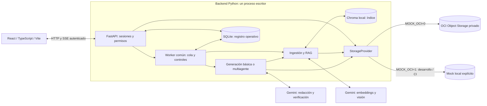
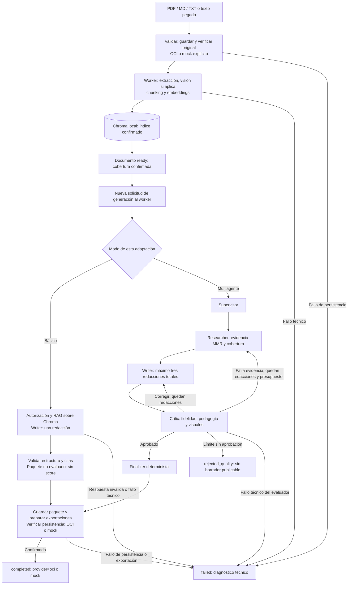

# NuevaMente — Documentación técnica para aprender

[](https://github.com/No-Country-simulation/G10-Equipo38-NuevaMente/actions/workflows/ci.yml?query=branch%3Adevelop)

**Hackathon Oracle Next Education (ONE) · Alura Latam · Grupo 10 · Equipo 38**

NuevaMente transforma documentos técnicos públicos o simulados en material de
estudio adaptado al perfil, sector, idioma y profundidad que necesita cada persona.
Ayuda a pasar de una documentación extensa a explicaciones, práctica y fuentes
consultables en el mismo espacio.

**Ir a:** [instalación](#instalación-y-ejecución-local) ·
[arquitectura](#arquitectura-implementada) · [uso inicial](#uso-inicial) ·
[evidencias](#cumplimiento-y-evidencia-disponible).

## Qué permite hacer

- Cargar PDF, Markdown, TXT o texto pegado y recuperar evidencia con ubicación en la fuente.
- Elegir cuatro perfiles, cinco formatos (tutorial, flashcards, quiz, resumen
  ejecutivo y guion de clase), cuatro sectores y contenido en español, inglés o portugués.
- Generar en modo **Multiagente**, con revisión factual, pedagógica y visual cuando
  corresponde, o **Básico**, con RAG y una redacción sin evaluación independiente.
- Estudiar flashcards, responder quizzes con feedback, consultar fuentes, chat y
  glosario, y conservar el progreso del espacio.
- Recuperar el historial mediante un código, comparar adaptaciones y descargar
  JSON, Markdown o PDF; las flashcards también admiten CSV, TSV y APKG para Anki.

La interfaz vigente es React, con tema Oracle oscuro y tipografías locales.
Streamlit fue retirado en #139. El seguimiento de generación usa SSE autenticado,
reconexión por cursor y cancelación cooperativa; recuperar el espacio permite
reencontrar trabajos activos sin crear otra generación. Ver [frontend](frontend/README.md),
[seguimiento SSE](docs/verificacion-issue-33.md), [estudio y cobertura React](docs/verificacion-issue-139.md)
y [descargas desde resultado e historial](docs/verificacion-issue-46.md).

La biblioteca permite consultar fuentes y ejemplos publicados previamente.
**La generación directa desde fuentes compartidas demo sigue pendiente**;
abrir un ejemplo guardado y generar desde un documento privado son recorridos distintos.
Alcance: [ejemplos demo](docs/ejemplos-demo.md).

## Estado del proyecto

Los componentes siguientes están implementados para ejecución local con los
proveedores y cuotas configurados. Existen [pruebas con dobles](docs/verificacion-issue-53.md)
y [evidencia real local con Gemini y OCI](docs/evidencia/issue-55/v2/README.md),
cada una con su versión y alcance. Esto no acredita una VM ni una URL pública
disponibles: la aceptación pública se conserva en [#133](https://github.com/No-Country-simulation/G10-Equipo38-NuevaMente/issues/133).
El objetivo de despliegue usa OCI Always Free, sujeto a verificación de la cuenta.

Las capturas actuales usan proveedores simulados; los registros reales conservan
su alcance histórico local. Faltan las tres salidas canónicas JSON de los
escenarios A/B/C v2, créditos nominales confirmados, instalación por un tercero
y revisión final del equipo. Sus entradas se documentan como reconstrucciones
trazables de los parámetros registrados, sin presentarlas como capturas originales.
Las contradicciones de #58/#133 y #60 se registran en
[trazabilidad del #57](docs/verificacion-issue-57.md); no se atribuyen revisiones humanas pendientes.

## React actual con proveedores simulados


**Captura simulada del 21/10/2026**, código `f1f9ae6`: carga en el área principal,
parámetros en el sidebar y fuente sintética lista. No acredita OCI/Gemini reales.
Ver [móvil](docs/evidencia/issue-57/movil-simulado.jpg),
[Básico sin score](docs/evidencia/issue-57/basico-simulado.jpg) y
[Multiagente con revisión sintética](docs/evidencia/issue-57/multiagente-simulado.jpg).
Las respuestas contienen marcadores del doble; no son ejemplos pedagógicos reales.
[Procedencia, dimensiones y límites](docs/evidencia/issue-57/README.md#capturas-actuales-de-react-simuladas).

## Stack y responsabilidades

| Componente | Tecnología | Responsabilidad |
|---|---|---|
| Interfaz | React 18, TypeScript, Vite | Parámetros, seguimiento, material de estudio, fuentes e historial; acceso HTTP a la API |
| API | Python 3.11, FastAPI, Pydantic v2 | Sesiones, permisos, contratos y admisión idempotente de trabajos |
| Worker común | Gestor propio y LangGraph en Multiagente | Ejecutar ingestión, generación, chat y glosario con cuotas, cancelación y deadlines compartidos |
| RAG | pypdf, pypdfium2, tiktoken, SDK Google GenAI | Extracción, interpretación visual cuando aplica, segmentación estructural, embeddings y recuperación MMR |
| Índice | ChromaDB local | Vectores y fragmentos filtrados por espacio y documento |
| Registro operativo | SQLite local | Sesiones, trabajos, eventos, idempotencia y obligaciones de limpieza |
| Archivos persistidos | OCI SDK / mock local explícito | Originales, manifiestos, paquetes, progreso recuperable y exportaciones |
| Exportaciones | ReportLab, genanki y renderizadores propios | Derivar archivos del paquete guardado sin nueva generación LLM |

Los modelos Gemini de generación, verificación y embeddings son configurables.
Las versiones fijadas están en [requirements del backend](backend/requirements.txt)
y [package.json del frontend](frontend/package.json).

## Arquitectura implementada

El backend concentra proveedores y datos; el navegador no accede a OCI ni a
Chroma. El worker pertenece al proceso backend, sin servicio de cola externo.



SQLite conserva el estado operativo y Chroma el índice de búsqueda; OCI conserva
los objetos durables. El mock de almacenamiento se selecciona al arrancar y no
se activa ante errores de OCI. La simulación de Gemini exige inyección explícita
de dobles: activar `MOCK_GEMINI=1` por sí solo no habilita un recorrido funcional.
Módulos, pruebas y límites de recuperación: [arquitectura detallada](docs/arquitectura.md).
Los dos diagramas cuentan con [parseo, renders e inspección local registrados](docs/evidencia/issue-57/mermaid/README.md).

Docker Compose empaqueta API y UI; Caddy, DNS y la VM OCI pertenecen a la receta
de publicación cuya aceptación externa sigue pendiente. Ver el
[runbook de despliegue #58](docs/despliegue-oci.md), sin inferir disponibilidad pública.

## Del documento al material de estudio

La ingestión guarda y verifica el original antes de indexarlo. Extrae texto e
interpreta las páginas visuales que lo requieren; después segmenta y genera
embeddings. Los embeddings sirven para recuperar evidencia, no para decidir los
cortes. El documento queda `ready` cuando se confirma el índice y la cobertura
necesaria. Cada nueva adaptación recupera evidencia autorizada mediante MMR.



**Básico** reutiliza autorización, recuperación y Writer sin ejecutar LangGraph
ni Critic. Valida el contrato y la localización de citas, pero no acredita
respaldo semántico ni aprobación independiente. **Multiagente** revisa hechos,
cobertura y adecuación pedagógica; el score por sí solo no aprueba. Finalizer
empaqueta lo revisado sin generar contenido educativo nuevo.

En ambos modos, `completed` exige persistencia confirmada. En Básico significa
material guardado con `status=no_evaluado`; en Multiagente, paquete aprobado y
guardado. Un fallo técnico no se convierte en rechazo factual ni activa Básico.
La cancelación cooperativa y los límites compartidos pueden interrumpir cualquiera
de los recorridos sin entregar el borrador. Detalle: [modos de generación](docs/modos-generacion.md)
y [arquitectura y correspondencia con código](docs/arquitectura.md).

## Instalación y ejecución local

Elegí un recorrido: **simulado funcional** para probar carga/generación sin
credenciales, **nativo real** para usar OCI/Gemini configurados, o **Docker con
mocks** para comprobar contenedores, UI y conectividad API. Docker con mocks no
inyecta el doble de generación. Detalle de lo ejecutado y de lo solo contrastado:
[registro de instalación](docs/verificacion-issue-57.md#b-comandos-efectivamente-ejecutados).

### Prerrequisitos y descarga

- Git 2.x y acceso a GitHub y a los registros de paquetes para descargar fuentes/dependencias.
- Para ejecución nativa: **Python 3.11** disponible como `python`, con `venv` y pip;
  **Node 24.15 o posterior dentro de la rama 24**, con npm. La CI usa Python 3.11
  y Node 24; las imágenes fijan Python 3.11.17 y Node 24.15.0. Python 3.11.9 y
  Node 24.19.0 se usaron en la comprobación local registrada.
- Alternativa Docker: Engine/Desktop con contenedores Linux y Compose v2
  (usar 2.24.4 o posterior); no requiere instalar Python/Node en el host.

Clonar en un directorio nuevo, desde su carpeta padre. PowerShell y Bash:

```console
git clone --branch develop --single-branch https://github.com/No-Country-simulation/G10-Equipo38-NuevaMente.git
cd G10-Equipo38-NuevaMente
```

Para los dos recorridos nativos, instalar desde esa raíz. No reutilizar un
entorno de otro proyecto ni sobrescribir una `.venv` existente. Los requirements
de desarrollo también son necesarios para el helper, que importa dobles de tests.

PowerShell (Windows; se usa `npm.cmd` para evitar depender de la política de scripts):

```powershell
python --version
node --version
python -m venv .venv
.venv\Scripts\python.exe -X utf8 -m pip install -r backend/requirements.txt -r requirements-dev.txt
npm.cmd --prefix frontend ci
```

Bash (Linux/macOS con Python 3.11 seleccionado como `python`):

```bash
python --version
node --version
python -m venv .venv
.venv/bin/python -X utf8 -m pip install -r backend/requirements.txt -r requirements-dev.txt
npm --prefix frontend ci
```

Continuar solo si cada comando termina sin error. `-X utf8` evita que pip lea los
comentarios de requirements como CP1252 en Windows. No es necesario activar el
entorno virtual: los comandos usan su intérprete explícitamente.

### 1. Recorrido funcional simulado

No crear ni copiar `.env` para este recorrido. En **terminal A**, desde la raíz:

```powershell
.venv\Scripts\python.exe -m backend.tests.integration.react_backend --data-dir .data/primer-recorrido --port 18080
```

En Bash, la misma orden comienza con `.venv/bin/python`. La carpeta
`.data/primer-recorrido` debe ser nueva; si existe, elegir otro nombre, sin borrarla.
Esperar el arranque de Uvicorn en `127.0.0.1:18080`. El helper cambia a ese directorio,
desactiva la lectura de `.env`, fija almacenamiento mock e inyecta embeddings y
generadores sintéticos con cuotas de prueba. Bloquea resolución DNS externa.
Usa SQLite, Chroma, worker y ambos recorridos de generación del proyecto.
Es una herramienta de verificación, no un modo de producción ni evidencia de
calidad de Gemini; comenzar con TXT/Markdown o texto pegado, sin páginas visuales.

En **terminal B**, también desde la raíz, arrancar React con el proxy explícito:

```powershell
$env:API_URL = 'http://127.0.0.1:18080'
npm.cmd --prefix frontend run dev -- --port 18501
```

Equivalente Bash:

```bash
API_URL=http://127.0.0.1:18080 npm --prefix frontend run dev -- --port 18501
```

Abrir **http://127.0.0.1:18501**. Vite envía `/api` al helper, no al puerto 8000.
Para comprobar esa conexión desde una tercera terminal:

```powershell
Invoke-RestMethod http://127.0.0.1:18501/api/health -TimeoutSec 10
```

En Bash: `curl --fail --max-time 10 http://127.0.0.1:18501/api/health`. Se espera `status: ok`;
después realizar el [uso inicial](#uso-inicial) para comprobar carga, generación y
descarga. El health por sí solo no comprueba esas funciones. Detener A y B con
Ctrl+C; los datos se conservan. El helper exige otro directorio nuevo al reiniciarlo.

### 2. Arranque nativo con OCI y Gemini reales

**Este recorrido fue contrastado con código/configuración y no fue ejecutado en la verificación local.**
Arrancar el proveedor OCI ya consulta servicios reales y contabiliza solicitudes.
Requiere una cuenta/bucket y cuotas disponibles, con consumo autorizado por el operador.
La configuración detallada de credenciales y permisos está en [OCI Storage](docs/oci-storage.md).

Desde la raíz, en una terminal nueva, preparar una carpeta que no exista:

```powershell
New-Item -ItemType Directory .data/local-real -ErrorAction Stop | Out-Null
Copy-Item .env.example .data/local-real/.env -ErrorAction Stop
```

Equivalente Bash, deteniéndose si la carpeta ya existe:

```bash
mkdir -p .data
mkdir .data/local-real && cp .env.example .data/local-real/.env
```

Si la carpeta existe, conservarla y elegir un nombre nuevo en todos los pasos.
Editar **solo el nuevo** `.data/local-real/.env`; no usar una configuración personal
como sustituto de estos requisitos:

| Variables | Valor/requisito para este recorrido |
|---|---|
| `APP_ENV`, `MOCK_OCI`, `MOCK_GEMINI` | `development`, `0`, `0`: servicios reales en loopback, sin activar el contrato de proxy de producción |
| `DATA_DIR` | `./state`, relativo a `.data/local-real`, no `/app/.data` del contenedor |
| `GOOGLE_API_KEY` | Clave real del proyecto de Google AI Studio, guardada en privado |
| `GEMINI_GENERATION_MODEL`, `GEMINI_VERIFICATION_MODEL`, `GEMINI_EMBEDDING_MODEL` | Modelos disponibles para esa clave; el template usa `gemini-2.5-flash`, `gemini-2.5-flash` y `gemini-embedding-2` |
| `EMBEDDING_DIMENSIONS` | `768` con el modelo del template; no cambiar sobre un índice existente incompatible |
| `EMBEDDING_QUOTA_*`, `GENERATION_QUOTA_*`, `VERIFICATION_QUOTA_*`, `VISION_QUOTA_*` | Descomentar y completar cada triple `RPM`, `TPM`, `RPD` con enteros positivos verificados en la cuenta. Si comparten modelo, los triples deben coincidir; no hay cuotas universales predeterminadas |
| `OCI_BUCKET_NAME`, `OCI_COMPARTMENT_ID`, `OCI_REGION` | Bucket privado preexistente `nuevamente-contenidos-educativos`, OCID del compartimento y home region real |
| `OCI_AUTH_TYPE`, `OCI_CONFIG_FILE`, `OCI_CONFIG_PROFILE` | `api_key`, ruta absoluta al config OCI fuera del repositorio y perfil correspondiente; su `key_file` debe apuntar a la clave privada existente |
| `OCI_ALWAYS_FREE_CONFIRMED` | `1` únicamente después de verificar asignación gratuita y consumo agregado de la cuenta; conservar o reducir los presupuestos del template |

No poner secretos en `VITE_*`, en comandos o en Git. Sin cuotas de embeddings no
se habilita carga; sin las de generación/verificación no se habilita el recorrido
completo. Sin visión configurada, un PDF que la requiera puede seguir `processing`.
Los errores de OCI no activan mock. La identidad de instancia y el despliegue de
producción se explican en el [runbook #58](docs/despliegue-oci.md).

En **terminal A**, desde la raíz, entrar al directorio de configuración y arrancar:

```powershell
cd .data/local-real
..\..\.venv\Scripts\python.exe -m uvicorn app.main:app --app-dir ../../backend --host 127.0.0.1 --port 8000 --workers 1 --no-access-log
```

En Bash, dentro de `.data/local-real`, usar `../../.venv/bin/python` con los mismos
argumentos. Pydantic carga el `.env` del **directorio de ejecución**; no el de la
raíz. Las variables ya exportadas en la terminal tienen prioridad: revisar que
no contradigan este archivo. `DATA_DIR` queda en `.data/local-real/state`.

En **terminal B**, desde la raíz del repositorio:

```powershell
$env:API_URL = 'http://127.0.0.1:8000'
npm.cmd --prefix frontend run dev
```

En Bash: `API_URL=http://127.0.0.1:8000 npm --prefix frontend run dev`.
Abrir **http://127.0.0.1:8501**; API/OpenAPI en **http://127.0.0.1:8000/docs**.
Se espera arranque sin errores y, al completar una adaptación real, persistencia
con `provider=oci`. El health no acredita la integración. Detener con Ctrl+C;
conservar `state`, sus ledgers y el código de recuperación al volver a arrancar.

### 3. Docker con mocks: arranque y conectividad

Usar un nombre de proyecto nuevo para aislar el volumen. Desde la raíz, en una
terminal sin servicios nativos ocupando 8000/8501:

```powershell
$env:NUEVAMENTE_ENV_FILE = '.env.docker.example'
docker compose --env-file .env.docker.example --project-name nuevamente-57-local up --build --detach --wait --wait-timeout 120
docker compose --env-file .env.docker.example --project-name nuevamente-57-local ps
Invoke-RestMethod http://127.0.0.1:8000/api/health -TimeoutSec 10
Invoke-RestMethod http://127.0.0.1:8501/api/health -TimeoutSec 10
```

En Bash, usar `export NUEVAMENTE_ENV_FILE=.env.docker.example`, las mismas órdenes
Compose y `curl --fail --max-time 10` en lugar de `Invoke-RestMethod`. El `--env-file` explícito
evita cargar `.env` de la raíz para interpolación; `NUEVAMENTE_ENV_FILE` selecciona
el archivo que recibe el backend. No copiar encima de configuraciones existentes.

Abrir **http://127.0.0.1:8501**. Se esperan servicios saludables, UI React y
`status: ok` tanto directo como por proxy. El frontend sirve el build y redirige
`/api` a `http://backend:8000`. El volumen nuevo guarda SQLite y almacenamiento
mock bajo `/app/.data`; solo se publican puertos en loopback.

**Este Compose no inyecta dobles de Gemini ni cuotas de prueba**: con el template
mock no permite comprobar carga/generación funcionales; esas solicitudes pueden
responder 503. Para ese recorrido usar el helper de la opción 1. Docker no se
ejecutó porque no está disponible en el entorno de verificación.
Persistencia, logs, credenciales en contenedores y operación:
[guía Docker](docs/docker.md) y [runbook OCI](docs/despliegue-oci.md).
Para detener sin borrar datos, desde esa misma terminal/raíz:

```console
docker compose --env-file .env.docker.example --project-name nuevamente-57-local stop
```

Conservar el volumen y el nombre de proyecto; no usar opciones de eliminación de volúmenes.

## Uso inicial

1. Abrir la UI del recorrido elegido: crea un espacio automáticamente. Guardar
   en privado el código de recuperación que se muestra una vez; el token queda en memoria.
2. En el área principal, cargar una fuente propia del espacio: archivo público o
   simulado PDF/MD/TXT, o texto pegado con título. Para el helper usar texto breve,
   por ejemplo: «Una red privada agrupa recursos. Una subred divide su rango de direcciones».
3. Esperar **ready**. `processing` o visión pendiente todavía no habilitan generación.
4. Elegir perfil, formato, sector, detalle, idioma y modo. Pulsar Generar y seguir
   las etapas; Básico no lleva Critic ni score. Cambiar de modo crea otro material,
   reutilizando el documento preparado.
5. Al terminar `completed`, abrir las fuentes para consultar las citas y descargar
   JSON/Markdown/PDF; CSV/TSV/APKG se ofrecen para flashcards. Un rechazo o fallo
   muestra diagnóstico, sin borrador descargable. En simulación el material y la
   revisión son sintéticos, aunque se puedan descargar.
6. Guardar el código antes de recargar/cerrar; recuperarlo permite volver al
   historial del espacio y sus materiales. La biblioteca compartida permite
   consultar ejemplos previos; generar directamente desde esas fuentes sigue pendiente.

## Escenarios de evidencia: A/B/C unidocumentales y D multidocumental

La [evidencia real local de #55 v2](docs/evidencia/issue-55/v2/README.md) registra
tres adaptaciones del mismo [PDF VCN v2](documents/redes_vcn_oci.pdf), con el mismo
ID de documento y SHA-256 verificado:
`fd57e3548ca593f167c297e2ad9bbcf2297bdb87985d003037d4afc5b5cc4d2e`.
En las tres, detalle `didactico` y alcance `documento_completo`.

A ellos se incorpora el **Escenario D** para verificar la síntesis multidocumental (§8.2 del plan correctivo).
Ilustra la resolución simultánea de múltiples fuentes con procedencia por cita (`document_id`), pero su
JSON proviene de una **simulación con dobles de prueba** sobre fuentes sintéticas: la ejecución real con
proveedores exigida por §8.2 sigue pendiente y no se presenta como realizada:

| Escenario | Alcance · Perfil · formato · sector · idioma | Fuentes utilizadas | JSON canónico de salida | SHA-256 verificado |
|---|---|---|---|---|
| A | 1 doc · Principiante · flashcards · general · ES | `redes_vcn_oci.pdf` | [Reconstrucción A](docs/evidencia/issue-57/entrada-vcn-a.reconstruida.json) | `83c654ea...` (esperado) |
| B | 1 doc · Junior/Semi Senior · tutorial · e-commerce · EN | `redes_vcn_oci.pdf` | [Reconstrucción B](docs/evidencia/issue-57/entrada-vcn-b.reconstruida.json) | `6528583a...` (esperado) |
| C | 1 doc · Ejecutivo · resumen ejecutivo · fintech · PT | `redes_vcn_oci.pdf` | [Reconstrucción C](docs/evidencia/issue-57/entrada-vcn-c.reconstruida.json) | `ea0ec80d...` (esperado) |
| D | 2 docs · Principiante · flashcards · general · ES | Arquitectura A + Arquitectura B (simuladas) | [Salida D](docs/evidencia/salida-multidocumental-d.json) | `9806ff5ddec0e919cb4f10213cfa92cdfe53575700183d8bc296585341c77107` (simulación con dobles; ejecución real pendiente) |

Las entradas de A/B/C copian los parámetros históricos del catálogo, validados contra el
contrato actual; **no son capturas HTTP originales**.
El Escenario D demuestra la mecánica de síntesis cruzada multidocumental y citas referenciadas
por fuente; su evidencia es simulada y su huella identifica los bytes exactos conservados en el
repositorio (los tests nunca la regeneran).
[Inventario y huellas esperadas](docs/evidencia/issue-57/README.md#escenarios-reales-abc-vcn-v2).

## Cumplimiento y evidencia disponible

La tabla contrasta el [enunciado](Enunciado/Enunciado%20-%20NuevaMente.pdf),
[decisiones §20](decisiones_proyecto.md#20-checklist-de-cumplimiento-de-requisitos)
y [plan §7](docs/plan-implementacion.md#7-matriz-de-trazabilidad-requisitos--issues).
Cada fila separa implementación y demostración: los tests enlazados son cobertura
existente, los informes conservan su fecha/proveedor y las capturas son simuladas.
La aceptación **pública** indicada debajo pertenece a [#133](https://github.com/No-Country-simulation/G10-Equipo38-NuevaMente/issues/133)
y permanece pendiente; el cierre de un issue no acredita su ejecución.

| Requisito mínimo | Implementación | Evidencia disponible | Aceptación pendiente |
|---|---|---|---|
| M1. Ingestión PDF/MD/TXT | [Ingestión/API](backend/app/documents/ingestion.py) | [#53: dobles](docs/verificacion-issue-53.md); TXT local simulado | Repetición pública |
| M2. Chunking, embeddings y búsqueda vectorial | [RAG/MMR](docs/arquitectura.md#4-pipeline-rag) | [#53](docs/verificacion-issue-53.md), [#55 real local](docs/evidencia/issue-55/v2/README.md) | Recorrido público |
| M3. Orquestación LLM | [Grafo](backend/app/core/agents/graph.py) | [#55 real local](docs/evidencia/issue-55/v2/README.md) | Calidad humana documentada y recorrido público |
| M4. Dos perfiles y dos formatos de una fuente | [Prompts y formatos](backend/app/core/agents/prompts.py) | [A/B/C v2 y entradas reconstruidas](docs/evidencia/issue-57/README.md#escenarios-reales-abc-vcn-v2) | Tres salidas canónicas JSON y ensayo #56 |
| M5. JSON estructurado e interfaz/API | [FastAPI/React](docs/arquitectura.md#2-diagrama-de-contenedores) | [#59 local](docs/verificacion-issue-59.md), [capturas simuladas](docs/evidencia/issue-57/README.md#capturas-actuales-de-react-simuladas) | API/UI públicas |
| M6. OCI Object Storage activo | [Proveedor OCI](backend/app/storage/oci_real.py) | [#54 real local](docs/evidencia/issue-54/README.md), [#55 v2](docs/evidencia/issue-55/v2/README.md) | Consola, constancia humana y aceptación #133 |
| M7. Tres ejemplos de ejecución | [Escenarios](backend/app/demo/scenarios.py) | [#55 v2](docs/evidencia/issue-55/v2/README.md); inventario anterior | JSON completos, demo #56 y recorrido público |
| M8. README, arquitectura e instalación | [Arquitectura](docs/arquitectura.md), guía anterior | [Auditoría documental](docs/verificacion-issue-57.md#matriz-final-documental-del-57) | Instalación por un tercero y revisión del equipo |

| Diferencial | Implementación | Evidencia disponible | Aceptación pendiente |
|---|---|---|---|
| D1. OCI Compute Always Free | [Runbook y receta](docs/despliegue-oci.md) | [#58: documentación/ensayos limitados](docs/verificacion-issue-58.md) | VM, gratuidad efectiva y HTTPS públicos; contradicción #58/#133 |
| D2. Multiagente LangGraph | [Cinco nodos y retornos](backend/app/core/agents/graph.py) | [#55 real local](docs/evidencia/issue-55/v2/README.md); captura simulada | Reporte humano #60 no disponible; recorrido público |
| D3. Quiz con feedback inmediato | [API de respuestas](backend/app/api/routes/progress.py) | [#55: acierto/error reales](docs/evidencia/issue-55/v2/informe.json), [#53](docs/verificacion-issue-53.md) | Ensayo humano #56, calidad #60 y prueba pública |
| D4. Interpretación de diagramas | [Multimodal](backend/app/core/rag/multimodal.py) | [#55 v2: imagen y revisión real local](docs/evidencia/issue-55/v2/README.md) | Recorrido visual en UI pública |
| D5. Exportación multiformato | [Exportadores](backend/app/exports/router.py) | [#54: MD/PDF/APKG](docs/evidencia/issue-54/README.md); JSON/MD/PDF simulados locales | Legibilidad/importación humana #56 y recorrido público |

| Extra acordado | Implementación | Evidencia disponible | Aceptación pendiente |
|---|---|---|---|
| X1. Chat RAG | [Servicio chat](backend/app/chat/service.py) | [Tests con dobles](backend/tests/test_chat.py) | Enlazar constancia real referida por #133 y completar recorrido público |
| X2. Glosario adaptado | [Servicio glosario](backend/app/glossary/service.py) | [Tests con dobles](backend/tests/test_glossary.py) | Revisión humana y recorrido público |
| X3. Progreso de estudio | [Servicio progreso](backend/app/progress/service.py) | [#53: recuperación](docs/verificacion-issue-53.md) | Protocolo humano #56 y público |
| X4. Historial recuperable | [Catálogo](backend/app/generations/catalog.py) | [Recuperación local](docs/verificacion-issue-57.md#b-comandos-efectivamente-ejecutados) | Protocolo #56 y público |
| X5. Comparación de adaptaciones | [Vistas React](frontend/src/components/StudyAndHistoryViews.tsx) | [Cobertura React #139](docs/verificacion-issue-139.md) | Ensayo humano #56 y público |
| X6. Biblioteca demo | [Catálogo demo](backend/app/demo/catalog.py) | [#55 v2 real local](docs/evidencia/issue-55/v2/README.md) | Puente demo→generación y aceptación pública |
| X7. ES/EN/PT | [Catálogos UI](frontend/src/i18n/index.ts) y prompts | [#55 multilingüe](docs/evidencia/issue-55/v2/README.md), [React #139](docs/verificacion-issue-139.md) | Reporte humano #60 y público |
| X8. Progreso SSE | [Cliente SSE](frontend/src/api/sse.ts) | [#33 con dobles](docs/verificacion-issue-33.md), [#53](docs/verificacion-issue-53.md) | Proxy público con proveedores reales |
| X9. Ver la fuente | [Fuentes React](frontend/src/components/SourcesDrawer.tsx) | [#55: citas/imagen](docs/evidencia/issue-55/v2/README.md); consultas locales simuladas | Revisión humana #56 y público |
| X10. Bloqueo de no aprobados en Multiagente | [Critic](backend/app/core/agents/critic.py) | [Rechazo real #55 v2](docs/evidencia/issue-55/v2/README.md), [#53](docs/verificacion-issue-53.md) | Revisión humana y público; Básico se rotula no evaluado |
| X11. Acceso anónimo por código | [Recuperación](backend/app/session/recovery.py) | [Comprobación local](docs/verificacion-issue-57.md#b-comandos-efectivamente-ejecutados), [aislamiento #51](docs/revision_seguridad.md) | Protocolo #56 y público |
| X12. Diseño oscuro y accesibilidad | [Estilos React](frontend/src/styles/oracle-theme.css) | Capturas simuladas; [cobertura #139](docs/verificacion-issue-139.md) | Teclado, foco, contraste y 320 px firmados en #56; capturas no certifican WCAG |

## Equipo y evidencia final de demo

**Grupo 10 · Equipo 38 — NuevaMente**, Hackathon Oracle Next Education / Alura Latam.
Los créditos nominales requieren una nómina explícita con nombre público,
usuario/enlace y rol confirmado por el equipo; las fuentes consultadas no la
aportan. No se deducen roles de los commits.
[Fuentes y datos necesarios](docs/evidencia/issue-57/README.md#créditos-y-evidencia-final-de-demo).

La evidencia final de guion, ensayo, grabación y protocolo humano se enlazará
cuando exista: por ahora, [seguimiento #56](https://github.com/No-Country-simulation/G10-Equipo38-NuevaMente/issues/56).
Las contradicciones de #58/#133 y #60 conservan su [registro](docs/verificacion-issue-57.md#contradicciones-y-pendientes-conservados);
no se atribuyen resultados humanos ni disponibilidad pública.

## API, calidad y revisiones pendientes

La [referencia de API](docs/api_reference.md) y el [OpenAPI versionado](docs/openapi.json)
describen los endpoints; los [contratos](docs/contratos-api.md) detallan los datos.
FastAPI ofrece `/docs` y `/openapi.json` en el backend local; eso no afirma su
publicación mediante Caddy. La cobertura y los protocolos existentes están en
[verificación E2E #53](docs/verificacion-issue-53.md).

Las comprobaciones realizadas y sus límites quedan en la
[matriz de verificación #57](docs/verificacion-issue-57.md#matriz-final-documental-del-57).
Siguen pendientes la instalación por una persona ajena al equipo
([plantilla para el voluntario](docs/evidencia/issue-57/protocolo-voluntario.md)),
el repaso con #56 y la revisión final del equipo.
**El #57 y la entrega pública no se consideran cumplidos.**
